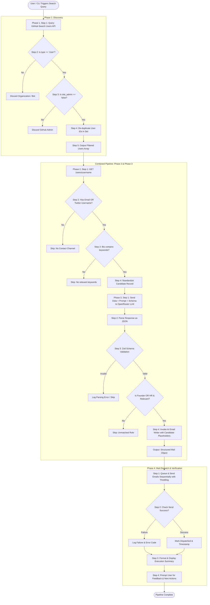

# Zobber AI: Detailed Execution Flow & Phase Specifications

This document provides an in-depth breakdown of every execution phase, detailing each step, data transformation, validation checkpoint, and error handling routine within **Zobber AI**.

---

## 🗺️ High-Level Lifecycle Flowchart



---

## 🔍 Phase 1: Candidate Discovery

**Objective**: Rapidly discover public profiles on GitHub matching user search queries and filter out irrelevant accounts before deeper queries.

### Step 1: GitHub User Search
- **API Endpoint**: `GET https://api.github.com/search/users?q={query}&per_page={per_page}&page={page}`
- **Parameters**:
  - `q`: Search terms (e.g., `"recruiter"`, `"tech talent"`, `"founder"`, `"CTO"`).
  - `per_page`: Number of results per request (default: 30, max: 100).
  - `page`: Pagination index.
- **Headers**:
  - `Accept: application/vnd.github+json`
  - `Authorization: Bearer <GITHUB_TOKEN>` (optional, but prevents IP rate limit exhaustion).

### Step 2: Entity Type Filtering
- Check `user.type`:
  - If `type === "User"`: Proceed.
  - If `type === "Organization"`: Discard immediately.

### Step 3: Administrative Account Filtering
- Check `user.site_admin`:
  - If `site_admin === false`: Proceed.
  - If `site_admin === true`: Discard (internal GitHub staff).

### Step 4: In-Memory De-duplication
- Maintain an active `Set<number>` of unique GitHub user IDs.
- If `previousIds.has(user.id)` is false: Add ID to the Set and accept candidate.
- If duplicate is found: Discard.

### Step 5: Output Collection
- Returns `GithubUserType[]` containing the filtered discovery items to pass to Phase 2.

---

## 🧬 Phase 2: Profile Enrichment & Heuristics

**Objective**: Retrieve deep metadata for each discovered candidate and execute fast heuristic pre-filtering to avoid unnecessary LLM calls.

### Step 1: Individual Profile Query
- **API Endpoint**: `GET https://api.github.com/users/${username}`
- Retrieves full profile JSON including public email, bio, Twitter handle, follower count, company, and hireable status.

### Step 2: Contact Channel Availability Check
- Verify if at least one direct contact method exists:
  $$\text{isValidContact} = (\text{email} \neq \text{null} \land \text{email} \neq "") \lor (\text{twitter\_username} \neq \text{null} \land \text{twitter\_username} \neq "")$$
- If neither exists, discard candidate immediately (cold email requires reachable contact).

### Step 3: Bio Heuristic & Keyword Matching
- Check if candidate's `bio` contains industry and role indicators:
  - Founder keywords: `founder`, `co-founder`, `ceo`, `cto`, `building`, `stealth`
  - HR & Recruiting keywords: `hr`, `recruiter`, `talent`, `hiring`, `people ops`, `head of people`
  - Technical lead keywords: `engineering manager`, `tech lead`, `head of engineering`
- If bio is empty or does not match any intent keywords, candidate is skipped.

### Step 4: Standardization to Canonical Candidate Model
Extract and normalize the profile:
- **`name`**: Required string (fallback to username if empty).
- **`company`**: String or `null` (cleaned of `@` prefixes).
- **`location`**: String or `null`.
- **`email`**: String or `null`.
- **`hireable`**: Boolean or `null`.
- **`bio`**: Trimmed string.
- **`twitter_username`**: String or `null`.
- **`followers`**: Number.

---

## ⚡ Combined Pipeline: Merging Phase 2 and Phase 3

Rather than storing all Phase 2 results before starting Phase 3, **Phase 2 and Phase 3 are piped sequentially per candidate**:

1. Candidate passed from Phase 1.
2. Phase 2 fetches `/users/${username}`.
3. If pre-filters fail, skip to next candidate.
4. If pre-filters pass, immediately invoke Phase 3 AI Decision Service.
5. This minimizes latency, conserves memory, and produces progressive streaming results.

---

## 🧠 Phase 3: AI Intelligence Engine & Decision Making

**Objective**: Classify the candidate's exact role, verify whether hiring is active, and generate a customized, highly relevant outreach email.

### Step 1: AI Prompt & Schema Dispatch
- The candidate's enriched profile is fed into the **Classification Prompt**.
- Handled through `OpenRouter` (`src/llm/openai.client.ts` / `src/llm/llm.service.ts`).
- Prompt instructs the LLM to inspect the candidate's bio, company, and hireable status.

### Step 2: JSON Response Extraction
- Ensure the model response conforms to strict JSON syntax.
- Handle potential Markdown code block wrapping (e.g., ````json ... ````) by stripping code fences.

### Step 3: Zod Schema Validation
Validate parsed JSON using Zod:
```typescript
const ClassificationSchema = z.object({
  role: z.enum(["founder", "hr", "other"]),
  isHiring: z.boolean(),
  hiringRole: z.string().nullable(),
  reasoning: z.string().optional()
});
```
- If role is `"other"`, candidate is discarded from outreach.
- If role is `"founder"` or `"hr"`, candidate moves to email generation.

### Step 4: AI Email Generation
- Candidate information and classification context (`role`, `company`, `hiringRole`, `name`) are passed to the **Email Writer Prompt**.
- Generates a tailored cold email draft:
  - Subject line tailored to their company and role.
  - Personalized opening hook referencing their bio or projects.
  - Body highlighting relevant value proposition.
  - Placeholders `{name}`, `{company}`, `{role}` properly injected or populated.

---

## ✉️ Phase 4: Cold Mail Dispatch & Tracking

**Objective**: Safely dispatch emails to qualified candidates, prevent spam trigger rates, track delivery statuses, and summarize outcomes.

### Step 1: Sequential Throttled Dispatch
- Dispatches emails one-by-one from the queue.
- Implements a configurable throttle delay (e.g., 2 to 5 seconds with random jitter) between outgoing emails to protect domain reputation.
- Injects final template variables and prepares headers.

### Step 2: Delivery Verification
- Executes transmission via SMTP client or mail service API (e.g., Resend, Nodemailer).
- Awaits delivery acknowledgment:
  - **Success**: Record message ID, recipient email, timestamp.
  - **Failure**: Capture error code (e.g., invalid mailbox, connection timeout, rate limit) and flag for retry or review.

### Step 3: Result Formatting & Reporting
- Compiles execution metrics:
  - Total candidates discovered (Phase 1)
  - Candidates passing enrichment (Phase 2)
  - Qualified leads classified (Phase 3)
  - Emails successfully sent (Phase 4)
  - Failed deliveries / Skipped candidates
- Outputs a clean, readable summary table in the console.

### Step 4: User Feedback Loop
- Prompts user for interactive review:
  - Option to view sent email transcripts.
  - Option to save successful leads to a report file.
  - Feedback on classification accuracy to fine-tune future prompt templates.
