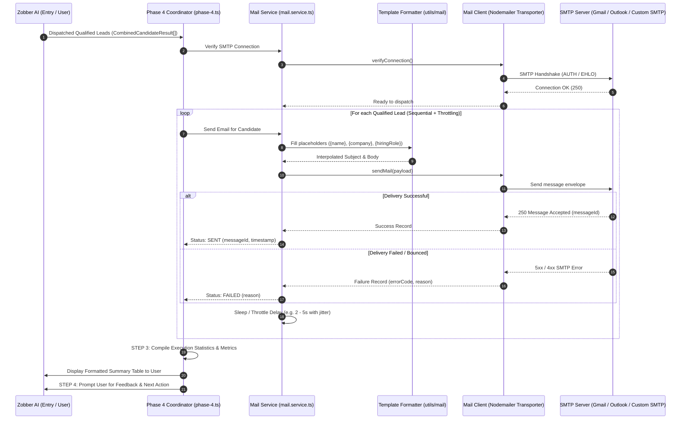

# Phase 4 System Design: Automated Cold Mail Outreach (Nodemailer)

> **Architectural blueprint, component responsibilities, data contracts, and delivery flows for Phase 4 of Zobber AI.**

---

## 1. Overview & Objective

Phase 4 is the final operational execution phase of Zobber AI. It takes qualified leads identified and generated in the combined Phase 2/3 pipeline, formats the emails with personal lead placeholders, dispatches them sequentially through an SMTP transport using **Nodemailer**, verifies delivery receipts, and generates an executive delivery summary.

---

## 2. Phase 4 Execution Steps (From Eraser Diagram)

```
┌────────────────────────────────────────────────────────────────────────┐
│                             PHASE 4 (MAIL)                             │
├────────────────────────────────────────────────────────────────────────┤
│ STEP 1: Sending mails one-by-one & filling information in mails        │
│ STEP 2: Check mail success fully go or not if yes okay or otherwise no │
│ STEP 3: Format result and show to user                                 │
│ STEP 4: Ask for feedback / next actions                                │
└────────────────────────────────────────────────────────────────────────┘
```

---

## 3. High-Level Component Architecture (SRP & OOP)

To maintain strict adherence to the **Single Responsibility Principle (SRP)**, Phase 4 is decomposed into dedicated layers:

```
src/
├── integrations/
│   └── mail/
│       ├── mail.client.ts        # Transporter wrapper: SMTP connection lifecycle & Nodemailer calls
│       ├── mail.types.ts         # SMTP config and raw transport types
│       └── mail.errors.ts        # Standardized email transport error handling
├── utils/
│   └── mail/
│       └── index.ts              # Template interpolation: Safely fills {name}, {company}, {role}
└── phases/
    └── phase-4/
        ├── mail.schema.ts        # Zod runtime validation for SMTP config & mail payloads
        ├── mail.types.ts         # High-level queue, delivery status, and summary report types
        ├── mail.service.ts       # Business service: Queueing, rate-limiting jitter, delivery verification
        └── phase-4.ts            # Phase coordinator: Runs Steps 1-4 end-to-end
```

---

## 4. Mermaid Flow Diagram



---

## 5. Module Breakdown & Responsibilities

### 5.1 Transport Layer (`src/integrations/mail/mail.client.ts`)
- **Single Responsibility**: Manage low-level Nodemailer transporter creation, credentials validation, and raw SMTP communication.
- **Methods**:
  - `initializeTransporter(config: SmtpConfig): void`
  - `verifyConnection(): Promise<boolean>`
  - `sendRawMail(mailOptions: RawMailOptions): Promise<SentMessageInfo>`

### 5.2 Template Utility Layer (`src/utils/mail/index.ts`)
- **Single Responsibility**: String interpolation of lead variables into subject and email body.
- **Supported Variables**:
  - `{name}` $\rightarrow$ Candidate's display name or username.
  - `{username}` $\rightarrow$ GitHub handle.
  - `{company}` $\rightarrow$ Target company name.
  - `{hiringRole}` $\rightarrow$ Target role they are hiring for.
  - `{role}` $\rightarrow$ Founder or HR.
- **Safety**: Replaces unpopulated variables with clean defaults or fallback text.

### 5.3 Mail Service Layer (`src/phases/phase-4/mail.service.ts`)
- **Single Responsibility**: Coordinate queue processing, anti-spam delay jitter, and error recording.
- **Anti-Spam Throttling**:
  - Injects a configurable pause (default: 2,000ms to 4,000ms with randomized jitter) between outgoing emails to protect domain reputation and prevent SMTP provider rate-limiting.
- **Methods**:
  - `sendCandidateMail(candidate: CombinedCandidateResult): Promise<DeliveryResult>`
  - `sendBatch(candidates: CombinedCandidateResult[]): Promise<DeliveryBatchReport>`

### 5.4 Phase Coordinator Layer (`src/phases/phase-4/phase-4.ts`)
- **Single Responsibility**: Orchestrate the 4 Eraser steps:
  - **Step 1**: Iterates through leads and fills placeholders.
  - **Step 2**: Evaluates delivery response for each recipient.
  - **Step 3**: Formats the final execution table:
    - Total Leads Received
    - Successful Deliveries
    - Failed / Skipped Deliveries
    - Delivery Timestamps & Message IDs
  - **Step 4**: Requests interactive user feedback and confirmation.

---

## 6. Data Contracts & Schemas

### 6.1 SMTP Configuration Schema (`mail.schema.ts`)
```typescript
import { z } from "zod";

export const SmtpConfigSchema = z.object({
  host: z.string().min(1, "SMTP host is required"),
  port: z.number().int().positive().default(587),
  secure: z.boolean().default(false), // true for 465, false for other ports
  auth: z.object({
    user: z.string().min(1, "SMTP user is required"),
    pass: z.string().min(1, "SMTP password is required")
  }),
  from: z.string().min(1, "Sender address ('from') is required"),
  throttleMs: z.number().int().min(500).default(3000)
});
```

### 6.2 Delivery Result Model (`mail.types.ts`)
```typescript
export interface DeliveryResult {
  username: string;
  recipientEmail: string;
  status: "SENT" | "FAILED" | "SKIPPED";
  messageId?: string;
  timestamp: string;
  error?: string;
}

export interface DeliveryBatchReport {
  totalProcessed: number;
  successfulCount: number;
  failedCount: number;
  skippedCount: number;
  results: DeliveryResult[];
  startTime: string;
  endTime: string;
}
```

---

## 7. Configuration (.env) Requirements

```env
# SMTP Mailer Settings
SMTP_HOST=smtp.gmail.com
SMTP_PORT=587
SMTP_SECURE=false
SMTP_USER=your_email@gmail.com
SMTP_PASS=your_app_password
EMAIL_FROM="Zobber AI Outreach <your_email@gmail.com>"
EMAIL_THROTTLE_MS=3000
```

---

## 8. Dependencies Required

To execute Phase 4, we require:
- `nodemailer` (Core transport library)
- `@types/nodemailer` (TypeScript definition library as a devDependency)
