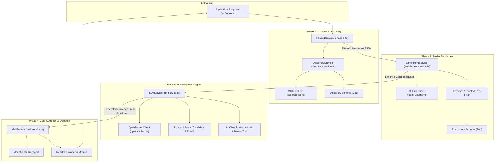
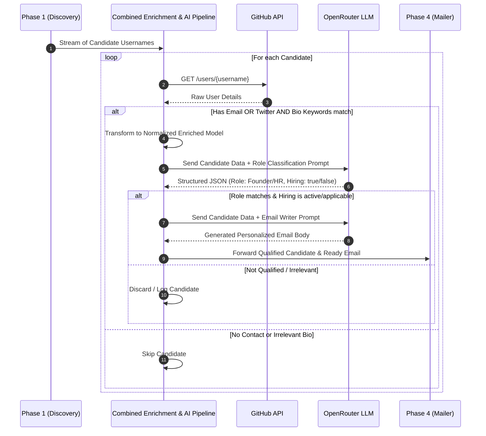

# System Architecture: Zobber AI

This document details the architectural design, component responsibilities, data contracts, and design principles governing **Zobber AI**.

---

## 1. Architectural Principles

Zobber AI is designed as an enterprise-grade automated bot and outreach tool built around key engineering tenets:

### 1.1 Single Responsibility Principle (SRP)
Every module and class is dedicated to exactly one domain responsibility:
- **Transport / Client Layer** (`integrations/`): Focuses solely on communicating with external HTTP endpoints (e.g., GitHub REST API, OpenRouter API, SMTP servers). It does not contain business filtering logic.
- **Service Layer** (`phases/`): Implements business workflows (e.g., filtering criteria, de-duplication, state transitions).
- **Schema & Validation Layer** (`*.schema.ts`): Houses Zod schemas and type definitions ensuring data integrity before and after operations.
- **LLM / Prompt Layer** (`llm/`, `prompts/`): Manages prompt templates, structured output parsing, and LLM calls.
- **Mapper Layer** (`*.mapper.ts`): Transforms raw external responses into domain models.

### 1.2 Object-Oriented & Class-Based Architecture
All services, clients, and pipeline coordinators are implemented as classes with clear public interfaces, encapsulated state, and typed dependencies. This provides:
- High testability (enables mocking clients in unit tests).
- Predictable lifecycle management.
- Clean separation between pure functions (utilities/schemas) and stateful/action-oriented classes (services/clients).

### 1.3 Schema-First Runtime Safety
TypeScript types disappear at runtime. To prevent silent failures when external APIs (GitHub, OpenRouter) return unexpected structures, all external data and LLM outputs are validated at runtime using **Zod**.

---

## 2. High-Level System Architecture Diagram



---

## 3. Merged Phase 2 + Phase 3 Architecture Approach

As established in the system design, **Phase 2 (Profile Enrichment)** and **Phase 3 (AI Intelligence)** are strategically merged in the execution pipeline:



### Why Combine Phase 2 and Phase 3?
1. **Low Overhead & Memory Optimization**: Phase 2 performs lightweight profile fetching and keyword heuristic matching. Storing intermediate data in storage or waiting for batch completion adds needless latency.
2. **Streamlined Pipeline Execution**: Candidates can be processed in a streaming/pipelined queue: as soon as a user profile is fetched and passes pre-filtering, it is immediately fed to the AI evaluation step.
3. **Fail-Fast Heuristics**: If a candidate lacks contact info (email/twitter) or has an empty/irrelevant bio, they are discarded before incurring costly LLM API token consumption.

---

## 4. Canonical Data Models & Schemas

### 4.1 Target Candidate Data Contract (Unified Output)

```typescript
export interface FinalCandidateRecord {
  username: string;
  email: string; // Validated and unique email address
  sources: {
    platform: "github" | "linkedin";
    url: string;
    collectedAt: string; // ISO 8601 Timestamp
  };
  role: "founder" | "hr";
  hiring: {
    status: boolean;
    url?: string;
    collectedAt: string; // ISO 8601 Timestamp
  };
  hiringRole: string | null;
}
```

### 4.2 Phase 2 Enriched Profile Schema
```typescript
export interface EnrichedCandidate {
  name: string;
  company: string | null;
  location: string | null;
  email: string | null;
  hireable: boolean | null;
  bio: string;
  twitter_username: string | null;
  followers: number;
  blog?: string | null;
  public_repos: number;
}
```

### 4.3 Phase 3 AI Evaluation Schema (Zod)
```typescript
import { z } from "zod";

export const AICandidateClassificationSchema = z.object({
  role: z.enum(["founder", "hr", "other"]),
  isHiring: z.boolean(),
  hiringRole: z.string().nullable(),
  reasoning: z.string().optional(),
  confidence: z.number().min(0).max(1)
});

export const AIGeneratedEmailSchema = z.object({
  subject: z.string(),
  body: z.string(),
  personalizedHook: z.string()
});
```

---

## 5. Directory Structure & Responsibilities

| Path | Responsibility |
|------|----------------|
| `src/index.ts` | Orchestrates the entire application flow and pipeline stages. |
| `src/integrations/github/` | Encapsulates GitHub HTTP calls, authentication headers, rate limit handling, and API mappers. |
| `src/integrations/mail/` | Encapsulates SMTP or third-party email delivery services (Resend, Nodemailer, etc.). |
| `src/phases/phase-1/` | User Discovery: queries search API, filters `type == User`, filters `site_admin == false`, de-duplicates IDs. |
| `src/phases/phase-2/` | User Enrichment: fetches full profile, checks email/twitter presence, filters bios matching keywords. |
| `src/phases/phase-3/` | AI Decision Engine: formats prompts, executes OpenRouter requests, parses and validates JSON via Zod, generates email. |
| `src/phases/phase-4/` | Email Dispatcher: manages mail queue, applies rate limits, sends emails, gathers success/failure status. |
| `src/prompts/` | Dedicated repository of system and user prompt templates for candidate analysis and email writing. |
| `src/utils/` | Shared utilities including validation wrappers, logging utilities, and string interpolation helpers. |

---

## 6. Resilience, Scalability & Security

1. **GitHub API Rate Limits**:
   - Unauthenticated GitHub requests are capped at 60 requests/hour (and 10 requests/minute for Search).
   - Authenticated requests with `GITHUB_TOKEN` provide 5,000 requests/hour (30 requests/minute for Search).
   - The integration layer will handle HTTP 403 / 429 rate limit errors with exponential backoff.
2. **LLM Structured Output Reliability**:
   - Uses OpenRouter with JSON schema mode or structured outputs.
   - Falls back to strict Zod parsing with clear error logging if parsing fails.
3. **Safe Outreach (Phase 4)**:
   - Configurable delay (jitter) between emails to prevent spam detection.
   - Strict de-duplication to ensure no recipient is emailed more than once.
   - Sanitized user data preventing template injection.
